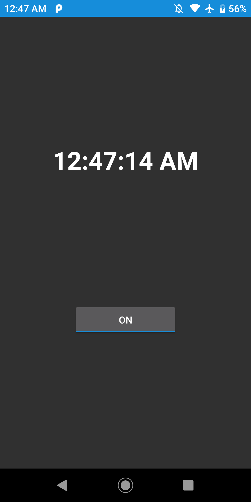

# Beeper

A simple hourly chime for Android. This application beeps twice in every full hour, once in every half hour to remind the user about time.

<p float="center">
	
</p>

## Why Beeper?

Development of Beeper started in 2020, to fix a problem of my own: I kept losing track of time. I missed the old Casio wristwatch I used to wear, the one that gave a small beep at the top of every hour, so I built the same thing for my phone. Two beeps on the hour, one on the half hour, and you notice the time passing without looking at a clock.

## Features

- Beep twice in every full hour
- Beep once in every half hour
- Turn on the reminders
- Turn off the reminders
- Keep the reminders after the device restarts

## Build & Run

Beeper runs on Android 4.2 (API level 17) and above and builds with Android Studio 4.2 or newer.

- Clone git repository:

	```sh
	git clone https://github.com/ermanergoz/Beeper.git
	```

- Import the project into Android Studio:
	- Open Android Studio. After that Click on “Open an existing Android Studio project”. If Android Studio is already open, click on File and then Click on Open.
	- Select the location of the cloned repository and then Click OK.
	- After Gradle operations are finished, the application will be ready to run.

## Application Architecture & Dependencies

Beeper follows MVVM. `MainActivity` is bound to `MainViewModel` with data binding, and the view model talks to `AlarmRepository`, which stores the on/off choice and schedules or cancels the chimes. Scheduling and storage sit behind the `AlarmScheduler` and `AlarmPreferences` interfaces, implemented with `AlarmManager` and `SharedPreferences` in the `data` package. Every chime schedules the next one, and the chimes are scheduled again after a reboot.

- [MVVM architecture](https://developer.android.com/jetpack/guide)
- [Data binding](https://developer.android.com/topic/libraries/data-binding)
- [Lifecycle](https://developer.android.com/topic/libraries/architecture/lifecycle) (ViewModel and LiveData)
- [Koin](https://insert-koin.io/) for dependency injection
- [AlarmManager](https://developer.android.com/training/scheduling/alarms) exact alarms that also fire in Doze mode

## Meta

Yusuf Erman ERGÖZ – erman.ergoz@gmail.com

Distributed under the MIT license. See ``LICENSE`` for more information.

[https://github.com/ermanergoz](https://github.com/ermanergoz)
